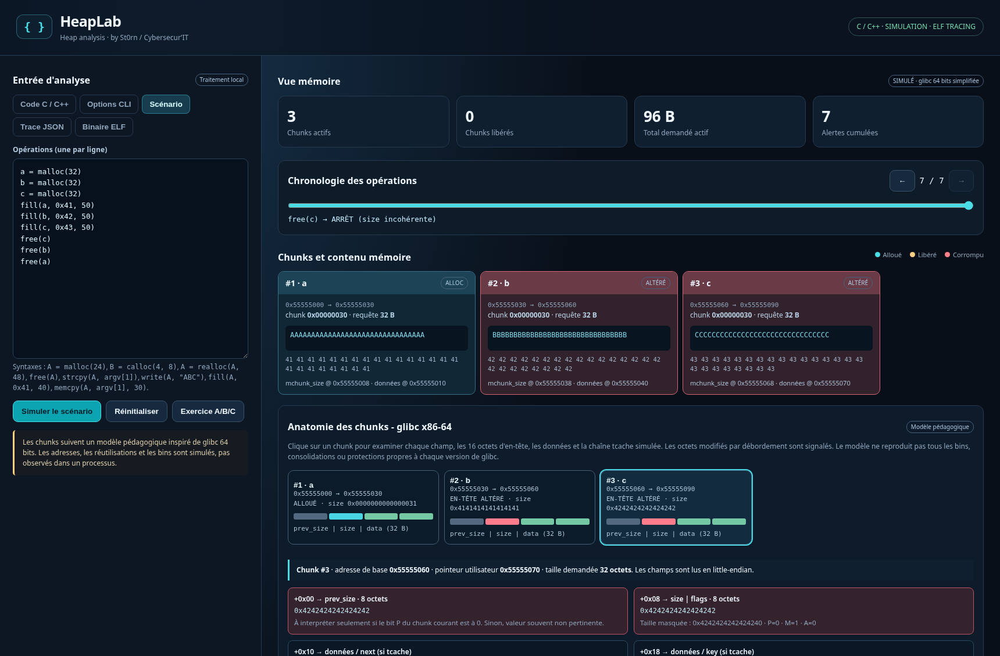
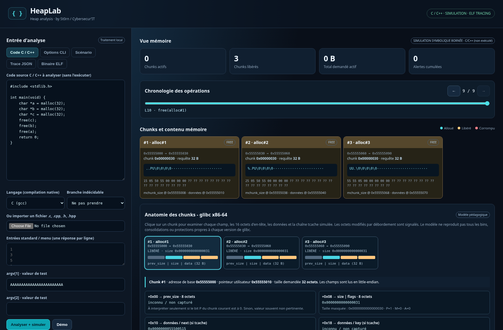
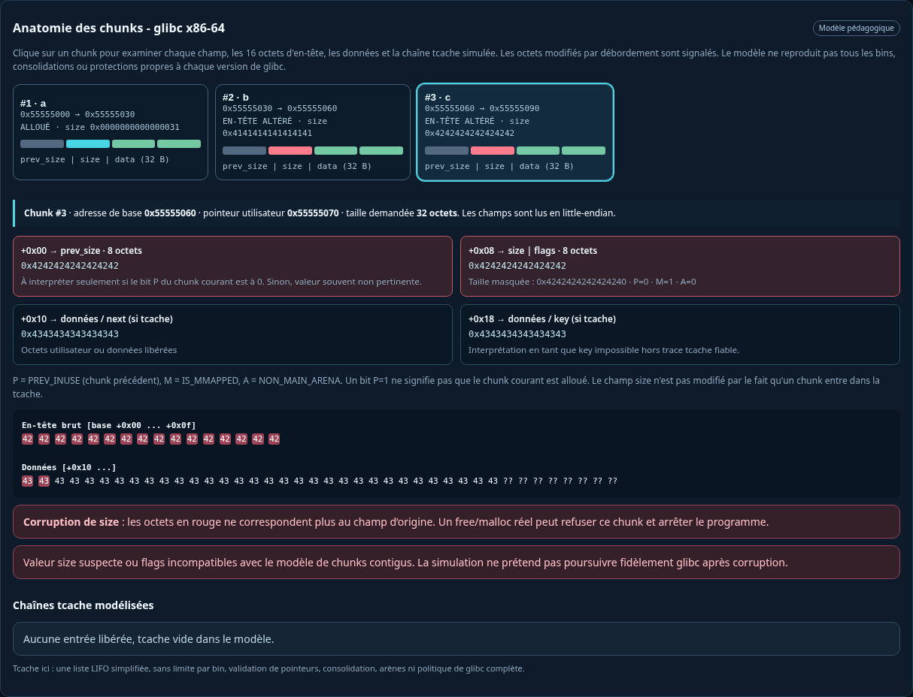
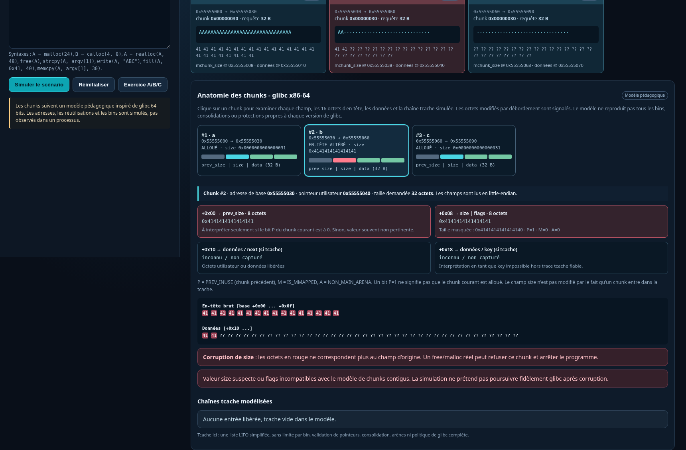

<div align="center">

# HeapLab


Exploration visuelle du heap, simulation de scénarios C/C++, inspection des chunks et traçage ELF sous Linux.

**St0rn** · **Cybersecur’IT**

`C / C++` &nbsp; `glibc x86-64` &nbsp; `Heap Overflow` &nbsp; `Chunk Inspector` &nbsp; `ELF Tracing` &nbsp; `Local-first`

</div>

---



<sub>Capture réelle de HeapLab : trois allocations de 32 octets, écritures de 50 octets, corruption des en-têtes B/C et arrêt simulé au premier `free()` invalide.</sub>

HeapLab permet de **construire une hypothèse**, d'examiner la disposition mémoire correspondante, puis de la comparer au comportement d'un programme réel. La frontière entre **simulation** et **observation native** est toujours explicite.

## Fonctionnalités

| Exploration | Ce que montre HeapLab |
| --- | --- |
| **Cartographie mémoire** | Chunks, adresses fictives, tailles demandées, tailles arrondies, statut d'allocation |
| **Heap overflow** | Octets écrits hors limites, en-têtes adjacents modifiés, champs corrompus |
| **Anatomie des chunks** | `prev_size`, `size`, flags `P / M / A`, données, représentation hexadécimale |
| **Tcache pédagogique** | Réutilisation de chunks et ordre LIFO ; modélisation volontairement simplifiée |
| **Scénarios** | `malloc`, `calloc`, `realloc`, `free`, `fill`, `strcpy`, `memcpy`, import/export JSON |
| **Code C / C++** | Analyse bornée d'un sous-ensemble du langage, paramètres, menus, boucles, structs |
| **ELF Linux** | Interception native de certains `malloc/free` via `LD_PRELOAD` |
| **Diagnostic** | Tests avec AddressSanitizer / UndefinedBehaviorSanitizer, distincts du modèle visuel |

## Captures de l'outil

**Disposition mémoire et chunks libérés**



**Inspection de l'en-tête corrompu**



<details>
<summary><strong>Voir l'étape intermédiaire : le premier débordement</strong></summary>



</details>

## Démarrer

### Simulation — navigateur uniquement

Ouvrir simplement **`index.html`** dans un navigateur moderne sous Windows, Linux ou macOS.

- Aucun serveur, paquet Python, compte ou accès Internet n'est nécessaire.
- Les fichiers C/C++ importés sont **interprétés partiellement**, **jamais exécutés** dans ce mode.
- Les adresses affichées sont fictives : le schéma sert à raisonner, pas à reproduire fidèlement l'allocateur du système.

### Observation native — Linux

Prérequis : Linux x86-64 avec glibc, Python, `gcc` et, pour le C++, `g++`.

```bash
sudo apt update
sudo apt install -y python3 gcc g++
./start-linux.sh
```

Ouvrir ensuite **http://127.0.0.1:8765**.

Le traceur est compilé localement à sa première utilisation. Aucun binaire natif précompilé n'est inclus dans ce dépôt.

> [!WARNING]
> **Le mode natif n'est pas un bac à sable.** Compiler ou importer un binaire peut exécuter du code arbitraire avec les permissions de ton utilisateur. Pour tester du code inconnu, utilise une VM isolée, sans secrets ni données importantes. Une confirmation explicite est demandée avant l'exécution.

## Reproduire le débordement présenté

Ouvrir l'onglet **Scénario**, puis utiliser **Exercice A/B/C**, ou coller :

```text
a = malloc(32)
b = malloc(32)
c = malloc(32)

fill(a, 0x41, 50)
fill(b, 0x42, 50)
fill(c, 0x43, 50)

free(c)
free(b)
free(a)
```

Déplacer le curseur de chronologie pour observer les écritures successives, puis cliquer sur le chunk **C** dans **Anatomie des chunks**.

Les octets `0x42` écrits depuis B remplacent notamment le champ `size` de C par `0x4242424242424242`. HeapLab marque les octets modifiés et **interrompt la simulation** au `free(c)` suivant : après une telle corruption, continuer à inventer des allocations serait trompeur.

## Ce qui est simulé — et ce qui ne l'est pas

| Mode | Nature des résultats | Limites |
| --- | --- | --- |
| **Scénario** | Modèle d'allocations et d'écritures | Pas de glibc réelle, pas de garantie sur la consolidation ni les bins |
| **Code C / C++** | Interprétation statique bornée | Syntaxe complexe, bibliothèques, concurrence et chemins indirects partiels |
| **Trace ELF** | Appels interceptés et snapshots natifs | Ne suit pas toutes les écritures, ni tous les allocateurs |
| **ASan / UBSan** | Diagnostic sur une exécution instrumentée | Disposition mémoire différente de l'exécution non instrumentée |

**Une alerte du simulateur n'est pas, à elle seule, une preuve d'exploitabilité.** Inversement, l'absence d'alerte ne démontre pas qu'un programme est sûr.

## Organisation du dépôt

```text
HeapLab/
├── index.html                 Interface web
├── app.js                     Navigation et intégration
├── engine.js                  Moteur des scénarios
├── chunk_inspector.js         Structures et inspection hexadécimale
├── source_sim.js              Interpréteur C/C++ borné
├── source_integration.js      Contrôles et analyse du code
├── server.py                  Serveur local et exécutions natives
├── tracer.c                   Interception malloc/free
├── start-linux.sh             Lancement sous Linux
├── assets/screenshots/        Captures authentiques de l'interface
├── examples/                  Programmes de démonstration
└── tests/                     Tests de non-régression
```

### Tests

```bash
bash tests/run-tests.sh
```

Les tests JavaScript nécessitent Node.js ; les tests natifs utilisent Python, `gcc` et glibc sur Linux x86-64.

---

<div align="center">

**HeapLab** — Built for understanding memory, not guessing at it.

Créé par **St0rn** · **[Cybersecur’IT](https://www.cybersecurit.fr)**

</div>
